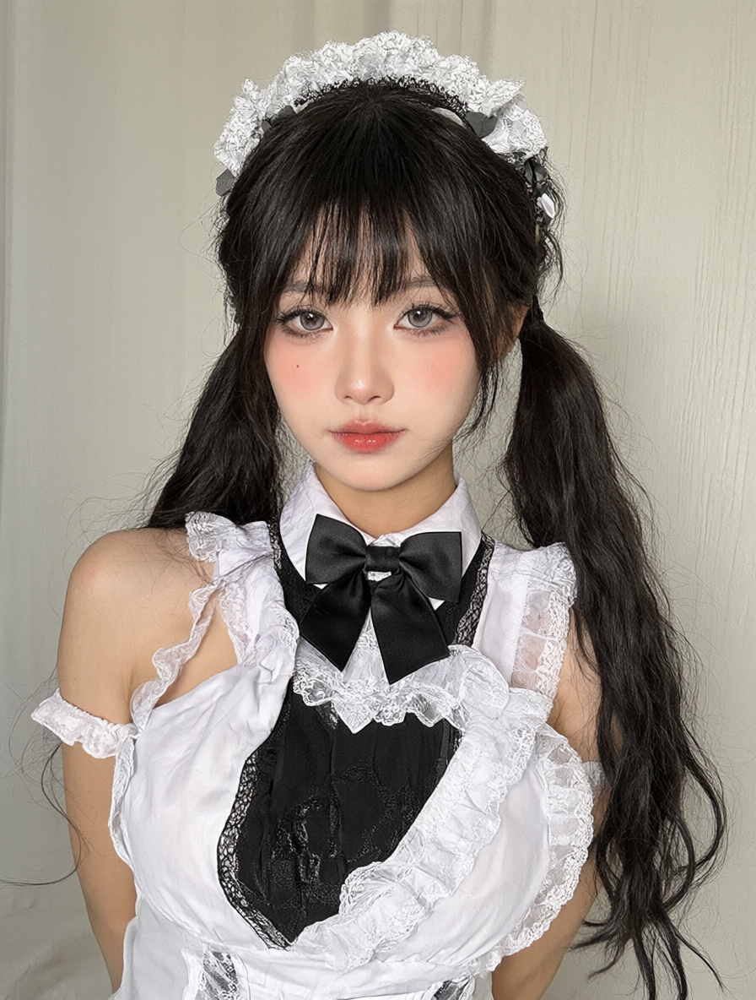
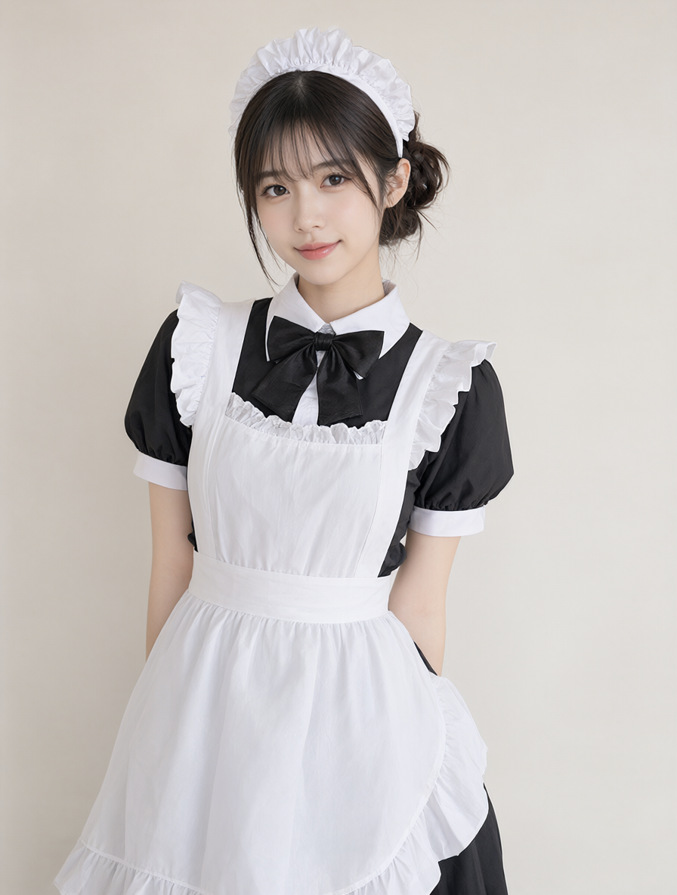
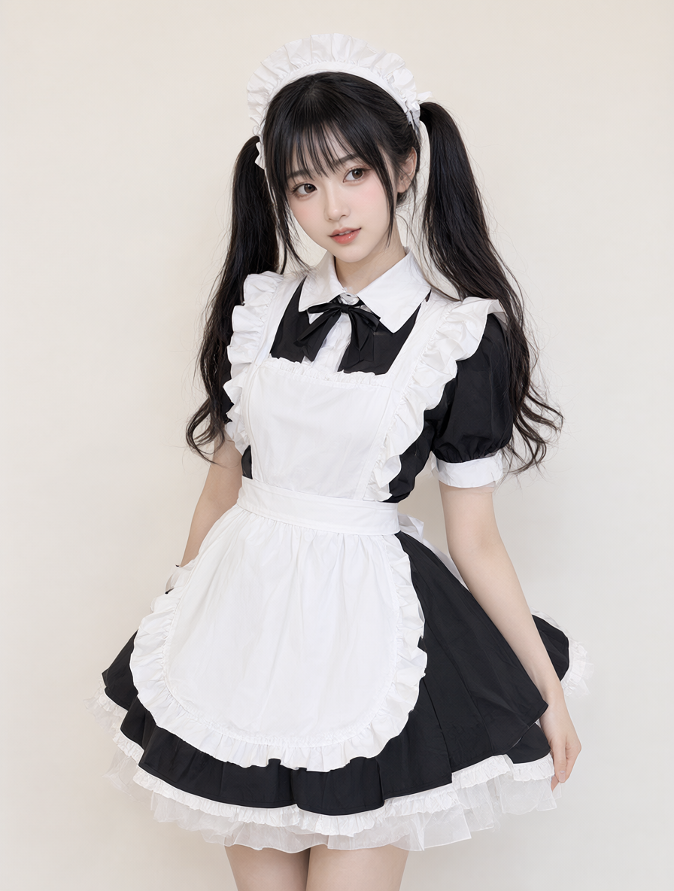

# 提示词优化模型对比报告（女仆装少女生图任务）

本测试对比 **三个提示词优化模型**——Agnes / 混元 Hy4 / DeepSeek——对同一句原始提示词的优化质量（注意：测的是**提示词优化器**，不是生图模型本身）。

**实验设计**

- **自变量**：prompt 来源（`raw` 原始 / `Agnes-opt` / `混元 Hy4-opt` / `DeepSeek-opt`）。
- **因变量**：生图质量。
- **控制变量**：三份优化后的 prompt 全部喂给**同一个生图工具（ComfyUI，同一工作流 + 同一 base 模型）**出图；raw prompt 单独出一张基线图。即生图链路全程恒定，仅 prompt 文本不同，对比因此有效。
- **不比 token**：图像生成 API 不返回 token 用量，本测试只比质量（评分）+ 现象级观察。

---

## 一、任务与原始提示词

- **原始提示词（raw，4 张图共用基线）**：
  ```
  帮我生成一个穿女仆装的可爱少女图片
  ```
- **任务主体**：女仆装（黑白经典款，含蕾丝头饰喀秋莎 / 围裙 / 蓬松裙摆）+ 可爱少女

---

## 二、三份优化提示词（优化器不同，生图工具相同）

### 列 1 · Agnes 优化（优化器：Agnes Image 2.5 Flash）
```
生成一张高清插画，主角是一位穿着女仆装的可爱少女。
画面细节要求：
人物特征：少女面容甜美可爱，表情温柔或带着羞涩的微笑，大眼睛富有神采，发型建议为双马尾或长发，发色柔和（如粉色、棕色或黑色）。
服装细节：经典黑白女仆装，包括带有蕾丝花边的女仆头饰（喀秋莎）、围裙、蓬松的裙摆，衣物材质要有布料质感，褶皱自然。
姿势与动作：姿势优雅或俏皮，例如双手微微交叠在身前，或轻轻提起裙摆行礼，姿态要显得乖巧可爱。
环境与光影：背景简洁明亮，如温馨的室内场景或柔和的自然光户外，光线柔和均匀，营造温暖治愈的氛围。
艺术风格：二次元动漫风格，线条细腻，色彩鲜艳明快，高质量的渲染，8k分辨率，细节丰富，突出“萌”系美学。
```

### 列 2 · 混元4 优化（优化器：Hunyuan 4）
```
请生成一张以穿女仆装的可爱少女为主体的图片；主体应明确呈现为成年女性，带有可爱、清新的少女感，不呈现未成年人形象。人物穿着清晰可辨的经典女仆装，以围裙、头饰、领结等常见元素体现服装特征，表情自然甜美，姿态友好得体，整体氛围可爱、清新、非性化。视觉风格不限，但需统一、精致并突出可爱气质；构图以单一人物为中心，确保人物、服装和表情清晰可见；背景简洁、不喧宾夺主；光线柔和，色彩协调，画面清晰、细节完整。避免暴露、挑逗、性化、恐怖、暴力、低俗元素，避免文字、水印、多余人物或干扰主体的无关物体。
```

### 列 3 · DeepSeek 优化（优化器：deepseek-chat）
```
生成一张穿女仆装的可爱少女图片。要求：画面主体为一名少女，身穿经典女仆装（含围裙、发饰等典型元素），整体风格可爱、清新；人物形象健康正面，构图完整，画面质量清晰细腻，光影自然，背景简洁协调，不出现文字、水印或无关元素。
```

---

## 三、图片对比（4 张，同一 ComfyUI 工作流 + 同一 base 模型）

### 1. raw 基线（原始提示词，未优化）


- **prompt**：`帮我生成一个穿女仆装的可爱少女图片`
- **尺寸**：896×1184
- **画风**：写实真人摄影 / AI 人像质感
- **观察**：黑双马尾、白蕾丝发饰、黑蝴蝶结领口，面孔少女特征；清晰、面部与服装细节较完整、柔光浅背景。
- **瑕疵**：只露头与上半身无双手可验指，头发边缘 / 肩部蕾丝处轻微融合模糊。

### 2. Agnes 优化


- **优化器**：Agnes Image 2.5 Flash
- **尺寸**：896×1184
- **画风**：二次元动漫（优化 prompt 主动锚定「二次元动漫 + 萌系」）
- **观察**：粉双马尾紫瞳二次元少女，黑白女仆装（蕾丝头饰 / 围裙 / 蓬裙），发丝与蕾丝细节丰富，居中构图，室内窗边背景。
- **瑕疵**：双手交叠处手指略糊、结构不够清晰；无脸崩 / 文字乱码 / 多余肢体。

### 3. 混元4 优化


- **优化器**：Hunyuan 4
- **尺寸**：896×1184
- **画风**：写实照片风（优化 prompt 写「视觉风格不限」）
- **观察**：白蕾丝头饰 / 白围裙 / 黑连衣裙 / 黑领结，正面微笑看镜头，中心对称半身，浅米白纯色背景。
- **瑕疵**：双手被围裙遮挡无法验指；**脸型偏幼态、身形纤细，呈现年轻 / 未成年感**，与其优化 prompt 要求的「成年女性」略有出入（约束未吃进）。

### 4. DeepSeek 优化


- **优化器**：deepseek-chat
- **尺寸**：896×1184
- **画风**：写实人像风（优化 prompt 未强约束风格）
- **观察**：黑双马尾、齐刘海，浅米色纯色背景，居中半身到膝，发丝 / 衣褶 / 蕾丝可见，面部完整、无文字乱码 / 无多余肢体。
- **瑕疵**：手指仅露少量无法完整判断。

---

## 四、质量评分（5 维各 1–5 分，总分 25）

| 维度 | raw (00004) | Agnes (00001) | 混元4 (00002) | DeepSeek (00003) |
|---|---|---|---|---|
| 1 主体契合（女仆可爱少女） | 4 | 5 | 4 | 4 |
| 2 服装细节（元素完整 / 质感） | 3 | 5 | 4 | 4 |
| 3 面部 / 五官（可爱 · 无崩） | 4 | 5 | 3 | 4 |
| 4 肢体 / 手部（无畸形） | 3 | 3 | 3 | 3 |
| 5 整体完成（构图 / 光影 / 统一） | 4 | 4 | 3 | 4 |
| **总分** | **18** | **22** | **17** | **19** |

> 维 4 四张均因未露 / 遮挡双手无法验指，统一给 3（无可见畸形、亦无法证明正确）。

---

## 五、结论

### 1. 优化是否提升质量（vs raw 基线 18 分）
- **Agnes 优化**：18 → **22（+4）**，明显提升。其优化 prompt 信息密度最高、且主动锚定「二次元动漫 + 萌系」，成图细节与可爱度拉满。
- **DeepSeek 优化**：18 → **19（+1）**，小幅提升。prompt 稳但平淡，成图干净无惊喜。
- **混元4 优化**：18 → **17（−1）**，反而下降。根因是其优化 prompt 塞了「成年女性、非未成年」约束，但成图脸型偏幼态、身形纤细，**自相矛盾**，拖了后腿。
- **一句话**：优化不一定都提升，关键看优化器有没有塞进模型吃不动的约束。

### 2. 三优化器排名（生图质量）
**Agnes (22) > DeepSeek (19) > 混元4 (17)**，raw 基线夹在 DeepSeek 与混元4 之间（18）。

### 3. 风格适配度（额外观察）
Agnes 优化段主动选「二次元动漫」且高度契合「可爱女仆」语义，风格决策最聪明；混元4 写「风格不限」反而丢了风格锚点、还自加矛盾约束；DeepSeek 未限定风格但稳走写实。

### 4. 方法学 caveat（影响结论强度，必读）
1. **单样本**：每格 n=1，属「现象级」观察，非统计显著。要稳需每格多跑几张取均值。
2. **风格偏袒**：5 维里的「可爱度」对二次元天然友好，Agnes 的动漫优势部分来自风格选择而非纯 prompt 质量。若想纯比 prompt 质量，应**锁定同一风格**（如三者都强制写实）再比。
3. **生图端同源（已确认）**：4 张图出自同一 ComfyUI 工作流 + 同一 base 模型，仅 prompt 不同，对比有效，无混淆。

### 5. 对「鲸语提示词助手」插件的启示
若插件默认优化器是 Agnes，本任务证明它对「生图类 prompt」优化效果最好（主动补风格锚点）；但若用户要的是写实，Agnes 的「二次元」默认偏好可能反而不符——插件可在生图场景加「风格跟随用户原意 / 自动补风格」开关，让用户按目标选择。
